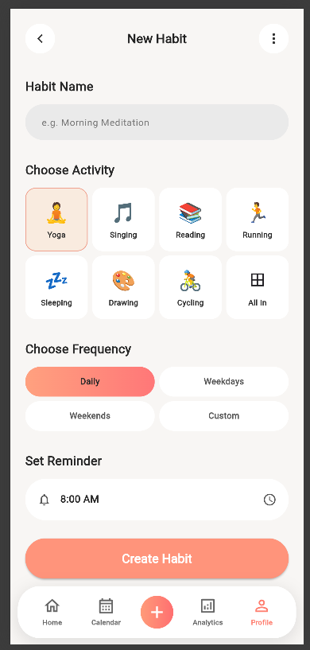

# Day 2 – Bottom Navigation Bar

## Overview

Day 2 focuses on building the Bottom Navigation Bar for the Flutter Habit Tracker application. The implementation also improves code organization by separating the UI components into individual reusable Dart files instead of keeping everything in a single file.

## Features Implemented

- **Home:** Navigation option for the home screen.
- **Calendar:** Navigation option for calendar-related activities.
- **Add Button:** Central button for adding a new item.
- **Analytics:** Navigation option for viewing habit analytics.
- **Profile:** Navigation option for user profile details.
- **Responsive Layout:** Floating navigation bar with rounded corners and shadow.
- **Reusable Widgets:** Separated UI components into individual Dart files.
- **Clean Code Structure:** Organized the project using screens, widgets, and models.

## Code Refactoring

Initially, the habit creation screen and its UI components were implemented in a single Dart file.

The code was refactored into separate files to improve readability, maintainability, and reusability.

### Updated Project Structure

```text
day2/
├── lib/
│   ├── main.dart
│   ├── models/
│   │   └── habit_icon_data.dart
│   ├── screens/
│   │   └── new_habit_screen.dart
│   └── widgets/
│       ├── add_navigation_button.dart
│       ├── bottom_navigation_bar.dart
│       ├── navigation_item.dart
│       ├── habit_header.dart
│       ├── habit_name_section.dart
│       ├── habit_icon_selector.dart
│       ├── habit_frequency_selector.dart
│       ├── reminder_time_section.dart
│       └── create_habit_button.dart
├── test/
├── web/
├── screenshot.png
├── pubspec.yaml
├── analysis_options.yaml
└── README.md
```

## Technologies Used

- Flutter
- Dart
- Material Design 3

## Run the Application

Install dependencies:


flutter pub get


Run in Chrome:


flutter run -d chrome


Check code quality:


flutter analyze


## Screenshot



## Learning Outcomes

- Understanding Flutter navigation components.
- Creating reusable widgets.
- Organizing Flutter applications using separate files.
- Understanding models, screens, and widgets.
- Improving code readability and maintainability.
- Applying responsive layouts and UI styling.

## Status

**Completed:** Day 2 – Bottom Navigation Bar and Code Refactoring
