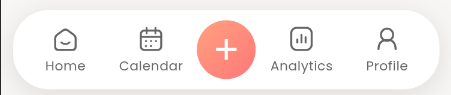
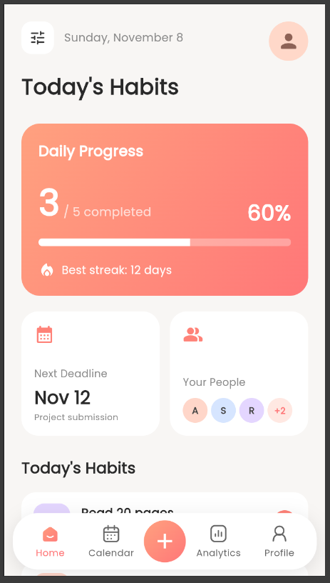

# Day 5 – Navigation Bar Refinement & Home Screen

## Overview

Day 5 focuses on refining the bottom navigation bar and creating the initial layout of the second screen (Home Dashboard) in the Flutter Habit Tracker application.

## Implementation Highlights

### Navigation Bar Refinement

- Replicated and refined the Home, Calendar, Analytics, and Profile navigation icons to closely match the reference design.
- Implemented an orange-to-pink linear gradient for all selected navigation icons.
- Applied matching gradient styling to selected navigation labels.
- Refined the Profile icon's head and shoulder proportions.
- Improved the plus button with a lighter icon and gradient circular background.
- Adjusted navigation bar dimensions, spacing, rounded corners, and shadow.
- Implemented responsive navigation label sizing to prevent text wrapping across different screen widths.
- Preserved existing navigation functionality.

### Second Screen – Home Dashboard

- Created the initial basic layout of the Home Dashboard.
- Added a Home screen header.
- Created a Daily Progress card.
- Added Deadline and People sections.
- Created a Today's Habits section with hardcoded sample data.
- Integrated the Home screen into the existing bottom navigation.

The Home Dashboard currently has a rough basic UI layout. Further visual refinement and improvements are planned for upcoming updates.

## Technologies Used

- Flutter
- Dart
- Material Design
- Custom Painters
- Linear Gradients

## Project Structure

```text
day5/
├── assets/
│   └── activity_icons/
├── lib/
│   ├── models/
│   ├── screens/
│   │   ├── home_screen.dart
│   │   ├── new_habit_screen.dart
│   │   └── placeholder_screen.dart
│   └── widgets/
│       ├── add_navigation_button.dart
│       ├── bottom_navigation_bar.dart
│       ├── navigation_item.dart
│       └── ...
├── screenshot1.png
├── screenshot2.png
└── README.md
```

## Screenshots




## Current Status

- Navigation Bar Refinement – Completed.
- Gradient Styling – Completed.
- Responsive Navigation Labels – Implemented.
- Home Dashboard – Initial UI Layout Created.
- Further Home Dashboard Refinement – Upcoming.
