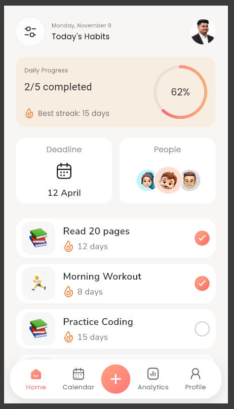

# Day 6 – Home Dashboard UI Refinement & Interactive Habit Cards

## Overview

Day 6 focuses on refining the Habit Tracker application's Home Dashboard UI and implementing interactive habit cards. The dashboard displays daily progress, deadlines, people, and today's habits with custom-designed UI components.

The application is developed using Flutter and Dart.

## Implementation Highlights

### 1. Home Dashboard
- Refined the Home Dashboard layout.
- Added a header with the current date and profile image.
- Implemented the Daily Progress card.
- Displayed daily completion progress and best streak information.
- Added Deadline and People sections.
- Integrated custom icons and profile avatars.

### 2. Interactive Habit Cards
- Added habit cards with activity illustrations.
- Displayed habit names and streak information.
- Implemented custom flame and completion icons.
- Added gradient styling for completed habit indicators.
- Enabled users to tap habit cards to toggle their completion status.

### 3. Profile Navigation
- Made the profile image clickable.
- Connected the profile image to the Profile navigation tab.
- Integrated navigation with the bottom navigation bar.

### 4. Custom UI Components

The application uses Flutter's `CustomPainter` for custom visual elements, including:

- `TuneIconPainter`
- `CalendarIconPainter`
- `GradientProgressPainter`
- `FlamePainter`
- `CheckIconPainter`

## Technologies Used

- Flutter
- Dart
- Material Design
- CustomPainter
- Asset Image Integration
- Nunito Sans Font

## Project Structure

```text
day6/
│
├── assets/
│   ├── activity_icons/
│   │   ├── all_in.png
│   │   ├── cycling.png
│   │   ├── drawing.png
│   │   ├── reading.png
│   │   ├── running.png
│   │   ├── singing.png
│   │   ├── sleeping.png
│   │   └── yoga.png
│   │
│   ├── fonts/
│   │   ├── NunitoSans-Regular.ttf
│   │   ├── NunitoSans-Bold.ttf
│   │   └── ...
│   │
│   ├── profile_icons/
│   │   ├── avatar_1_girl.png
│   │   ├── avatar_2_boy.png
│   │   └── avatar_3_man.png
│   │
│   └── profile.png
│
├── lib/
│   ├── models/
│   │   └── habit_icon_data.dart
│   │
│   ├── screens/
│   │   ├── home_screen.dart
│   │   ├── new_habit_screen.dart
│   │   └── placeholder_screen.dart
│   │
│   ├── widgets/
│   │   ├── add_navigation_button.dart
│   │   ├── bottom_navigation_bar.dart
│   │   ├── create_habit_button.dart
│   │   ├── daily_progress_card.dart
│   │   ├── deadline_people_section.dart
│   │   ├── habit_frequency_selector.dart
│   │   ├── habit_header.dart
│   │   ├── habit_icon_selector.dart
│   │   ├── habit_name_section.dart
│   │   ├── home_header.dart
│   │   ├── navigation_item.dart
│   │   ├── reminder_time_section.dart
│   │   └── today_habits_section.dart
│   │
│   └── main.dart
│
├── test/
│   └── widget_test.dart
│
├── android/
├── ios/
├── linux/
├── macos/
├── web/
├── windows/
│
├── screenshot.png
├── analysis_options.yaml
├── pubspec.yaml
├── pubspec.lock
├── .gitignore
└── README.md
```

## Getting Started

### Prerequisites
- Flutter SDK
- Dart SDK
- Visual Studio Code

### Installation

Clone the repository:

```bash
git clone <https://github.com/Pradhapraja704/yuvi-flutter-challenge>
```

Navigate to the project directory:

```bash
cd day6
```

Install dependencies:

```bash
flutter pub get
```

Run the application:

```bash
flutter run
```

## Screenshot



## Current Status

- Home Dashboard UI refinement completed.
- Daily Progress card implemented.
- Deadline and People sections integrated.
- Interactive habit completion implemented.
- Profile navigation integrated.
- Custom UI painters implemented.
