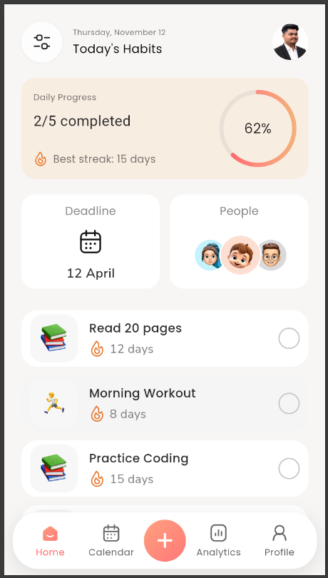
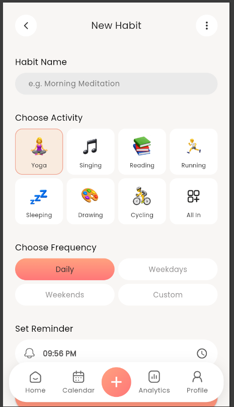

# Day 7 – Habit Tracker Dashboard Mockup Replication

## Overview

Day 7 focuses on successfully recreating the provided Habit Tracker Dashboard UI mockup using Flutter. The implementation follows the reference design with attention to layout, typography, colours, spacing, gradients, icons, and overall visual appearance.

The application is developed using Flutter and Dart, with reusable widgets and custom UI components to maintain a structured and maintainable codebase.

## Implementation Highlights

### 1. Home Dashboard UI

- Successfully recreated the provided Habit Tracker Dashboard mockup.
- Implemented the Home Dashboard header with date information and profile image.
- Designed the Daily Progress card with gradient styling and completion indicators.
- Implemented the Deadline and People sections.
- Refined component dimensions, spacing, alignment, and rounded corners to closely match the reference design.

### 2. Today's Habits Section

- Implemented habit cards with activity illustrations.
- Added habit names and streak information.
- Applied Poppins typography for habit names.
- Used Nunito Sans typography for streak information.
- Integrated custom flame and completion icons.
- Implemented interactive habit completion using StatefulWidget and setState.
- Added gradient styling for completed habit indicators.

### 3. Custom UI Components

- Created custom-painted icons for specific UI elements.
- Refined the back navigation chevron using CustomPainter.
- Implemented a custom bell icon for the reminder section.
- Integrated Lucide Icons and reusable Flutter icon components.
- Maintained consistent icon sizing, stroke width, and alignment.

### 4. Reminder Time Formatting

- Refined the reminder time display.
- Implemented zero-padded hour and minute formatting.
- Ensured consistent time display, such as `08:00 AM`.

### 5. Navigation and Reusable Widgets

- Integrated the existing bottom navigation structure.
- Maintained navigation between the Home, Calendar, Add, Analytics, and Profile sections.
- Organized the UI into reusable widgets.
- Preserved the existing Habit Creation screen components.

## Technologies Used

- Flutter
- Dart
- Material Design
- Google Fonts – Poppins
- Nunito Sans
- Lucide Icons
- CustomPainter
- StatefulWidget and setState

## Project Structure

```text
day7/
│
├── assets/
│   ├── activity_icons/
│   ├── fonts/
│   ├── profile_icons/
│   └── profile.png
│
├── lib/
│   ├── models/
│   │   └── habit_icon_data.dart
│   │
│   ├── screens/
│   │   ├── home_screen.dart
│   │   ├── new_habit_screen.dart
│   │   └── placeholder_screen.dart
│   │
│   ├── widgets/
│   │   ├── add_navigation_button.dart
│   │   ├── bottom_navigation_bar.dart
│   │   ├── create_habit_button.dart
│   │   ├── daily_progress_card.dart
│   │   ├── deadline_people_section.dart
│   │   ├── habit_frequency_selector.dart
│   │   ├── habit_header.dart
│   │   ├── habit_icon_selector.dart
│   │   ├── habit_name_section.dart
│   │   ├── home_header.dart
│   │   ├── navigation_item.dart
│   │   ├── reminder_time_section.dart
│   │   └── today_habits_section.dart
│   │
│   └── main.dart
│
├── test/
├── android/
├── ios/
├── linux/
├── macos/
├── web/
├── windows/
│
├── analysis_options.yaml
├── pubspec.yaml
├── pubspec.lock
├── screenshot.png
└── README.md
```

## Getting Started

### Prerequisites

- Flutter SDK
- Visual Studio Code

### Installation

Navigate to the Day7 project directory:

```bash
cd day7
```

Install dependencies:

```bash
flutter pub get
```

Run the application in Chrome:

```bash
flutter run -d chrome
```

Analyze the code:

```bash
flutter analyze
```

## Screenshot




## Current Status

- Habit Tracker Dashboard Mockup Replication – Completed.
- Home Dashboard UI Implementation – Completed.
- Daily Progress and Deadline Sections – Implemented.
- Interactive Habit Cards – Implemented.
- Custom UI Components – Implemented.
- Typography and Visual Refinement – Completed.
- Reminder Time Formatting – Completed.
- Bottom Navigation Integration – Completed.
